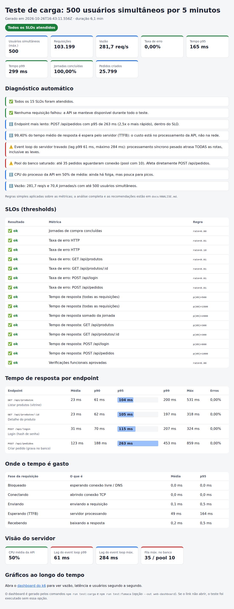

# Análise do teste de carga: 500 usuários simultâneos por 5 minutos

Este documento interpreta o relatório gerado pelo k6 (Tarefa 2). O relatório completo desta execução está em [`docs/exemplo-relatorio/index.html`](exemplo-relatorio/index.html), com os gráficos ao longo do tempo em [`dashboard.html`](exemplo-relatorio/dashboard.html).

---

## 1. Resumo executivo

A API **suportou 500 usuários simultâneos por 5 minutos sem nenhum erro e dentro de todos os 15 SLOs definidos**. O p95 geral ficou em 165 ms (limite de 500 ms) e todas as 25.799 jornadas de compra terminaram com pedido criado.

O resultado, porém, **não é folgado**. As métricas do servidor mostram dois gargalos já ativos nesta carga, que hoje só aumentam a latência, mas serão os primeiros pontos a quebrar se o tráfego crescer:

1. **CPU / event loop bloqueado pelo hash de senha síncrono do login.** O event loop chegou a ficar travado 284 ms, e por isso até rotas triviais tiveram p95 de cerca de 100 ms.
2. **Pool de conexões do banco saturado nos picos.** Até 35 pedidos ficaram na fila esperando uma das 10 conexões.

A estimativa é de **folga de aproximadamente 1,7 a 2 vezes** a carga atual antes de os SLOs começarem a ser violados. Isso precisa ser confirmado com um teste de estresse (ver seção 7).

---

## 2. Ambiente e metodologia

| Item | Valor |
|---|---|
| Ferramenta | k6 v2.3.0 |
| Alvo | API mock do projeto (`api/server.js`, Node.js, processo único) |
| Perfil de carga | 30 s de subida até 500 VUs, **5 min de platô com 500 VUs**, 30 s de descida |
| Jornada por VU | listar produtos → detalhe → login → criar pedido, com pausas aleatórias de 0,5 a 3 s entre as ações |
| Execução analisada | 6,1 min, 103.199 requisições |

**Por que uma API mock e não uma API pública?** Disparar 500 usuários por 5 minutos contra uma API pública de terceiros (JSONPlaceholder, ReqRes etc.) é, na prática, um ataque de negação de serviço. Viola os termos de uso dessas APIs e o resultado mede o *rate limit* e a rede, não a aplicação. O enunciado permite API de mock. A mock deste projeto reproduz características reais (CPU no login, I/O com pool de banco) e expõe métricas internas, o que permite **identificar gargalos de verdade**, e não só medir tempos.

**Limitação importante:** nesta execução, o k6 e a API rodaram na **mesma máquina, com 1 vCPU**. Os 500 VUs do k6 disputam CPU com a API, o que infla parte da latência. Os números absolutos mudam conforme o hardware (o runner do GitHub Actions tem mais núcleos), mas as **tendências e os gargalos identificados são estruturais** e se repetem. Num ambiente real, o gerador de carga fica numa máquina separada do sistema testado.

---

## 3. Resultados principais

| Indicador | Resultado | SLO | Situação |
|---|---|---|---|
| Taxa de erro HTTP | 0,00% (0 de 103.199) | < 1% | ✅ |
| Tempo de resposta p95 / p99 | 165 ms / 299 ms | < 500 ms / < 1.500 ms | ✅ |
| Verificações funcionais | 100% (206.392 aprovadas) | > 99% | ✅ |
| Jornadas concluídas | 100% (25.799 pedidos) | > 99% | ✅ |
| Tempo da jornada (soma das requisições) p95 | 414 ms | < 2.000 ms | ✅ |
| Vazão | 281,7 req/s · 70,4 jornadas/s | — | — |

### 3.1 Por endpoint

| Endpoint | Sem carga (fumaça, p95) | Com 500 VUs: mediana | p95 | p99 | Máx | SLO p95 |
|---|---|---|---|---|---|---|
| `GET /api/produtos` | ~3 ms | 8 ms | 104 ms | 200 ms | 531 ms | 300 ms ✅ |
| `GET /api/produtos/:id` | ~2 ms | 8 ms | 105 ms | 197 ms | 318 ms | 300 ms ✅ |
| `POST /api/login` | ~11 ms | 16 ms | 115 ms | 207 ms | 324 ms | 800 ms ✅ |
| `POST /api/pedidos` | ~103 ms | 107 ms | 263 ms | 453 ms | 859 ms | 1.000 ms ✅ |

O dado mais revelador está nas duas primeiras linhas. Listar produtos é só fatiar um array em memória (cerca de 3 ms sem carga). Mesmo assim, o p95 subiu para 104 ms, **cerca de 35 vezes mais**. A mediana continua baixa (8 ms), então a maioria das requisições é rápida, mas uma em cada vinte espera mais de 100 ms **sem fazer nada pesado**. Esse padrão, uma cauda longa em rotas leves, é a assinatura de requisições **esperando na fila**, não sendo processadas devagar.

### 3.2 Onde o tempo é gasto

| Fase | Média | p95 |
|---|---|---|
| Bloqueado (esperando conexão) | 0,0 ms | 0,0 ms |
| Conectando (TCP) | 0,0 ms | 0,0 ms |
| Enviando | 0,1 ms | 0,5 ms |
| **Esperando o servidor (TTFB)** | **49 ms** | **164 ms** |
| Recebendo | 0,2 ms | 0,5 ms |

**99,4% do tempo é espera pela resposta do servidor.** Rede, conexão e transferência são desprezíveis. O *keep-alive* funcionou: as conexões foram reaproveitadas e nenhum VU esperou por conexão livre. Com isso, a rede e o gerador de carga ficam descartados como causa principal, e a investigação vai para dentro da aplicação.

---

## 4. Gargalos identificados

### 4.1 Gargalo 1: event loop bloqueado pelo hash de senha (CPU)

**Evidências:**

- Lag do event loop do Node: **p99 de 61 ms e máximo de 284 ms**. Sem carga, fica abaixo de 5 ms.
- Rotas que não fazem nada pesado (`/api/produtos`) com p95 de cerca de 100 ms e mediana de 8 ms.
- CPU média do processo em 50%, com um único processo Node.

**Causa:** o login calcula o hash da senha com `crypto.pbkdf2Sync` (10.000 iterações, cerca de 5,5 ms por chamada nesta máquina). Por ser **síncrono**, enquanto calcula o hash o Node não atende **nenhuma** outra requisição. A 70 logins por segundo, isso dá aproximadamente 385 ms de CPU por segundo, ou seja, **cerca de três quartos de toda a CPU usada pela API**. Quando vários logins chegam juntos, eles se enfileiram e todas as outras rotas esperam atrás deles: daí os picos de 284 ms.

**Por que importa:** o problema não fica restrito ao login. Ele degrada **todos** os endpoints ao mesmo tempo. A CPU cresce de forma aproximadamente linear com o número de usuários, então com cerca de 2 vezes a carga atual o processo chega a 100% de um núcleo. A partir daí a fila cresce sem limite e os tempos de resposta disparam.

### 4.2 Gargalo 2: pool de conexões do banco (I/O)

**Evidências:**

- Fila máxima de **35 pedidos aguardando conexão**, com um pool de 10.
- `POST /api/pedidos` com média de 123 ms, quando a gravação em si leva em média 80 ms. São cerca de 40 ms de fila em média.
- Cauda longa: p99 de 453 ms e máximo de 859 ms.

**Análise de capacidade (Lei de Little):** com 70,4 pedidos por segundo e 80 ms por gravação, ficam em média 5,6 conexões ocupadas das 10 disponíveis, uma utilização média de 56%. A fila de 35 aparece porque as chegadas **não são uniformes**: quando o event loop destrava após um bloqueio (gargalo 1), ele despacha de uma vez as requisições que estavam represadas, e o pool recebe rajadas. **Os dois gargalos se reforçam.**

A capacidade teórica do pool é de 10 / 0,08 s, ou **cerca de 125 pedidos por segundo**, 1,8 vez a vazão atual. Acima disso a fila deixa de esvaziar entre as rajadas e o tempo de `POST /api/pedidos` cresce sem limite.

### 4.3 Risco identificado na revisão do código: sessões nunca expiram

A API guarda todo token emitido num mapa em memória e **nunca remove nenhum**. Neste teste foram 25.799 tokens em 6 minutos, o que dá centenas de milhares por hora de operação. O teste de 5 minutos não chega a mostrar o efeito, mas num teste de resistência (*soak*) o consumo de memória cresceria continuamente até a coleta de lixo começar a pesar ou o processo cair. É um gargalo latente que só um teste longo revelaria.

---

## 5. Como ler os gráficos

O [dashboard do k6](exemplo-relatorio/dashboard.html) mostra a evolução segundo a segundo. Os pontos a observar para confirmar (ou refutar) a análise acima são:

- **Vazão (req/s) × usuários:** durante a rampa, a vazão deve subir junto com os VUs e, no platô, ficar estável. Se ela cair com os usuários constantes, a API entrou em colapso. Nesta execução não houve colapso: zero erros e todas as jornadas concluídas.
- **Tempo de resposta no platô:** estável com picos isolados indica um sistema em equilíbrio, onde os picos são os bloqueios do event loop. Uma linha subindo continuamente indicaria fila acumulando, e o teste estaria acima da capacidade.
- **Erros:** qualquer degrau na taxa de falhas marca o momento exato em que algum limite foi atingido. É o primeiro gráfico a olhar num teste de estresse.

## 6. Conclusão

| Pergunta | Resposta |
|---|---|
| A API aguenta 500 usuários simultâneos por 5 minutos? | **Sim.** 0% de erro e todos os SLOs atendidos. |
| Há folga? | **Pouca: cerca de 1,7 a 2 vezes.** CPU a 50% e pool do banco com utilização média de 56% e rajadas na fila. |
| O que quebra primeiro? | O **event loop / CPU** (login síncrono), seguido de perto pelo **pool do banco**. As estimativas dos dois convergem para algo entre 900 e 1.000 usuários. |
| A rede ou o k6 são o problema? | **Não.** 99,4% do tempo é processamento no servidor e não houve espera por conexão. |

---

## 7. Recomendações

**Correções na aplicação (por impacto):**

1. **Tornar o hash de senha assíncrono.** Trocar `pbkdf2Sync` por `crypto.pbkdf2` (ou bcrypt/argon2 assíncronos). O cálculo passa a rodar no *thread pool* do libuv e o event loop fica livre para as outras rotas. É a correção de maior efeito, com mudança de poucas linhas.
2. **Escalar horizontalmente.** Usar vários processos (Node `cluster`, PM2 ou réplicas atrás de um balanceador) para usar todos os núcleos. Hoje a API usa no máximo um.
3. **Reduzir a quantidade de logins.** Na jornada real, o usuário faz login uma vez por sessão, não a cada compra. Reaproveitar tokens (com *refresh token*) reduz drasticamente a carga de CPU.
4. **Ajustar o pool do banco** com base na capacidade real do banco (testar 20 a 30 conexões) e monitorar o tempo de espera por conexão como métrica de alerta.
5. **Expirar sessões** (TTL no mapa, ou Redis com expiração) para eliminar o vazamento de memória.

**Próximos testes:**

| Teste | Objetivo | Como |
|---|---|---|
| **Estresse** | Encontrar o ponto de ruptura e confirmar a estimativa de 900 a 1.000 VUs | `k6 run -e VUS=1500 -e RAMPA=5m -e DURACAO=2m tests/carga.js` e observar onde os SLOs quebram |
| **Resistência (soak)** | Confirmar o vazamento de memória das sessões | 300 VUs por 1 a 2 horas, monitorando a memória do processo |
| **Comparativo** | Medir o ganho de cada correção | Repetir este teste após cada mudança e comparar os `resumo.json` |
| **Gerador separado** | Remover a disputa de CPU entre k6 e API | Rodar o k6 em outra máquina, ou usar Grafana Cloud k6 |
